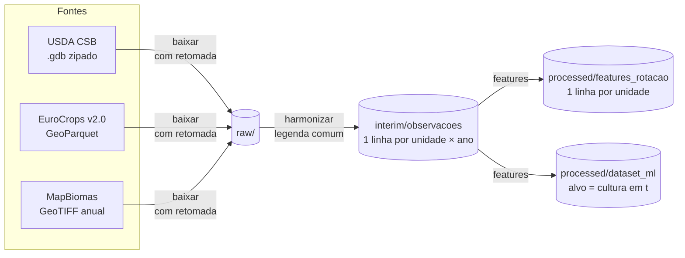

# Rotação de Culturas: dados globais para Machine Learning

Pipeline em Python que **baixa, harmoniza e transforma em dataset de ML** dados de rotação de culturas de três fontes abertas:

- 🇺🇸 Estados Unidos: **USDA NASS Crop Sequence Boundaries**
- 🇪🇺 União Europeia: **EuroCrops v2.0**
- 🇧🇷 Brasil: **MapBiomas Coleção 10**

O resultado é um conjunto de tabelas Parquet com o mesmo esquema e a mesma legenda de culturas para os três continentes. Ele está pronto para treinar modelos que preveem a próxima cultura, estudam padrões de rotação ou usam a rotação como variável explicativa (de produtividade ou de demanda hídrica, por exemplo).

---

## Sumário

1. [Motivação](#1-motivação)
2. [Fontes de dados](#2-fontes-de-dados)
3. [Como o pipeline funciona](#3-como-o-pipeline-funciona)
4. [Instalação](#4-instalação)
5. [Uso rápido](#5-uso-rápido)
6. [Referência de comandos](#6-referência-de-comandos)
7. [Organização dos dados](#7-organização-dos-dados)
8. [Esquema das tabelas](#8-esquema-das-tabelas)
9. [Harmonização das culturas](#9-harmonização-das-culturas)
10. [Features de rotação](#10-features-de-rotação)
11. [Exemplo: treinando um modelo](#11-exemplo-treinando-um-modelo)
12. [Estrutura do código](#12-estrutura-do-código)
13. [Testes com dados sintéticos](#13-testes-com-dados-sintéticos)
14. [Como adicionar uma nova fonte](#14-como-adicionar-uma-nova-fonte)
15. [Limitações conhecidas](#15-limitações-conhecidas)
16. [Solução de problemas](#16-solução-de-problemas)
17. [Licenças e citação](#17-licenças-e-citação)

---

## 1. Motivação

Não existe um dataset global pronto de rotação de culturas. A rotação precisa ser **reconstruída**: pegamos mapas ou declarações anuais de "qual cultura estava em cada área" e lemos a sequência de cada talhão ao longo dos anos.

Cada fonte, porém, tem o seu próprio formato, os seus códigos de cultura, a sua projeção e o seu idioma. O USDA usa códigos numéricos do Cropland Data Layer, o EuroCrops usa códigos nacionais traduzidos para a taxonomia HCAT4, e o MapBiomas usa classes de uso da terra. Este projeto resolve isso em três etapas:

1. **Padroniza o download**, com retomada, registro de procedência e verificação de integridade.
2. **Converte** todas as culturas para uma **legenda comum**.
3. **Calcula features** de rotação e monta um **dataset supervisionado** sem vazamento de informação do futuro.

## 2. Fontes de dados

| | USDA CSB | EuroCrops v2.0 | MapBiomas Col. 10 |
|---|---|---|---|
| **Cobertura** | EUA (48 estados + DC) | 18 regiões de 16 países da UE | Brasil |
| **Unidade** | talhão (polígono) | talhão declarado na PAC | pixel de 30 m (amostrado) |
| **Período** | janelas de 8 anos, de 2008–2015 a 2018–2025 | 2008–2023 (varia por região) | 1985–2024 |
| **Formato original** | File Geodatabase (.gdb) zipado | GeoParquet (EPSG:3035) | GeoTIFF anual (EPSG:4326) |
| **Códigos de cultura** | Cropland Data Layer (CDL) | códigos nacionais → HCAT4 | classes MapBiomas |
| **Safra dupla** | sim (ex.: trigo de inverno → soja) | não | não |
| **Licença** | domínio público | CC BY 4.0 | CC BY 4.0 |

**Regiões do EuroCrops:**

| Código | Região | Código | Região |
|---|---|---|---|
| `at` | Áustria | `ee` | Estônia |
| `be2`, `be3` | Bélgica (Flandres, Valônia) | `es` | Espanha |
| `bg` | Bulgária | `fi` | Finlândia |
| `cz` | República Tcheca | `fr` | França |
| `de4`, `dea` | Alemanha (Brandemburgo, Renânia do Norte-Vestfália) | `ie` | Irlanda |
| `dk` | Dinamarca | `iti1` | Itália (Toscana) |
| `nl` | Países Baixos | `pt` | Portugal |
| `si` | Eslovênia | `sk` | Eslováquia |

## 3. Como o pipeline funciona



**Etapa 1: download** (`raw/`). Cada arquivo é baixado uma única vez. Se a conexão cair, o download continua de onde parou (HTTP Range). Cada arquivo baixado ganha uma linha em `metadata/catalogo_downloads.csv`, com URL, tamanho, hash SHA-256, data e licença.

**Etapa 2: harmonização** (`interim/`). Para cada fonte, o pipeline:
- lê as colunas de cultura de cada ano;
- traduz os códigos para a legenda comum;
- calcula um ponto interno de cada unidade em WGS84 (lon/lat) e a sua área em hectares;
- grava uma **tabela longa** com uma linha por unidade e ano.

**Etapa 3: features** (`processed/`). Processa uma partição (fonte, país, região) por vez, para caber na memória, e gera:
- `features_rotacao`: um resumo da rotação de cada unidade (sequência, diversidade, monocultura etc.);
- `dataset_ml`: uma linha por unidade e ano *t*, cujo alvo é a cultura de *t* e cujas entradas são as culturas de *t-1*, *t-2* e *t-3*.

### Como cada fonte vira uma sequência

- **USDA CSB:** cada talhão já traz uma coluna por ano (`CDL2018` … `CDL2025`). Basta "derreter" as colunas em linhas.
- **EuroCrops:** o arquivo `<região>_stack.parquet` já cruza os talhões de todos os anos (colunas `c<ano>`). Se uma região não tiver stack, o pipeline pega o ponto interno de cada talhão do ano mais recente e descobre, por junção espacial, o que foi declarado naquele ponto em cada ano anterior.
- **MapBiomas:** não há talhões. Como todos os anos estão na mesma grade, o mesmo pixel (linha, coluna) é a mesma área em todos os anos. O pipeline sorteia pixels dentro da área de interesse, mantém os que tiveram lavoura temporária em pelo menos *N* anos e lê a classe de cada ano. Para ser eficiente, faz uma única leitura por bloco interno do GeoTIFF.

## 4. Instalação

Requer **Python 3.10+**.

```bash
git clone <seu-repositório> rotacao_culturas
cd rotacao_culturas
python -m venv .venv
source .venv/bin/activate          # Windows: .venv\Scripts\activate
pip install -r requirements.txt
```

Dependências principais: `pandas`, `pyarrow`, `geopandas`, `pyogrio`, `shapely`, `pyproj`, `rasterio`, `requests` e `tqdm`.

## 5. Uso rápido

```bash
# 1. EUA: talhões do Corn Belt, 2018–2025
python pipeline.py usda --janela 2018-2025 --estados IA IL NE MN

# 2. Europa: França, Dinamarca e Países Baixos
python pipeline.py eurocrops --regioes fr dk nl

# 3. Brasil: 50 mil pixels agrícolas no Mato Grosso, 2015–2024
python pipeline.py mapbiomas --anos 2015-2024 --uf MT --pontos 50000

# 4. Features de rotação + dataset de ML
python pipeline.py features --lags 3

# 5. (opcional) exportar as tabelas de conversão de culturas em CSV
python pipeline.py legendas
```

> ⚠️ **Os arquivos são grandes.** O zip nacional do CSB e cada GeoTIFF anual do MapBiomas passam de 1 GB, e os stacks do EuroCrops da França e da Espanha também são pesados. Comece com poucos estados, regiões e anos.

## 6. Referência de comandos

Opção global, válida para todos os comandos:

| Opção | Padrão | Descrição |
|---|---|---|
| `--dados PASTA` | `dados` | pasta raiz dos dados (também pode ser definida pela variável `ROTACAO_DADOS`) |

### `usda`: Crop Sequence Boundaries

| Opção | Padrão | Descrição |
|---|---|---|
| `--janela` | `2018-2025` | janela de 8 anos (de `2008-2015` a `2018-2025`) |
| `--estados` | todos | siglas (`IA IL`) ou códigos FIPS (`19 17`). Sem esta opção, processa o país inteiro em lotes de 1 milhão de talhões |
| `--arquivo` | — | usar um `.zip` já baixado |
| `--so-baixar` | — | só baixar, sem harmonizar |
| `--salvar-geometria` | — | gravar os polígonos em GeoParquet (só com `--estados`) |

### `eurocrops`: EuroCrops v2.0

| Opção | Padrão | Descrição |
|---|---|---|
| `--regioes` | **obrigatório** | um ou mais códigos da tabela da seção 2 |
| `--versao` | mais nova disponível | pasta do FTP: `gpqtv202`, `gpqtv201` ou `gpqt` |
| `--anuais` | — | baixar também os arquivos anuais |
| `--so-baixar` | — | só baixar, sem harmonizar |
| `--salvar-geometria` | — | gravar os polígonos em GeoParquet |

### `mapbiomas`: MapBiomas Coleção 10

| Opção | Padrão | Descrição |
|---|---|---|
| `--anos` | `2015-2024` | intervalo (`2015-2024`) ou lista (`2020,2022,2024`) |
| `--uf` | — | UF com retângulo pré-definido: BA, GO, MA, MG, MS, MT, PI, PR, RS, SC, SP, TO |
| `--bbox` | — | retângulo `LON_MIN LAT_MIN LON_MAX LAT_MAX` |
| `--limite` | — | arquivo vetorial (gpkg/shp/geojson) com o polígono exato da área |
| `--nome-regiao` | `AOI` | rótulo da região quando `--uf` não é usado |
| `--pontos` | `50000` | número de pixels agrícolas a amostrar |
| `--min-anos-lavoura` | `2` | mínimo de anos com lavoura temporária para o pixel entrar na amostra |
| `--semente` | `42` | semente do sorteio (garante reprodutibilidade) |
| `--pasta-tifs` | — | usar GeoTIFFs já baixados (`brazil_coverage_<ano>.tif`) |
| `--so-baixar` | — | só baixar, sem amostrar |
| `--salvar-geometria` | — | gravar o quadrado de cada pixel em GeoParquet |

> Os retângulos do `--uf` são aproximados e pegam pedaços dos estados vizinhos. Para um recorte exato, passe a malha do estado do IBGE em `--limite`.

### `features`: features e dataset de ML

| Opção | Padrão | Descrição |
|---|---|---|
| `--lags` | `3` | quantos anos anteriores entram como entrada do modelo |
| `--min-anos-lavoura` | `2` | unidades com menos anos de lavoura temporária ficam fora do dataset de ML |
| `--fontes` | todas | limitar a `usda_csb`, `eurocrops` e/ou `mapbiomas` |

### `legendas`: exportar tabelas de conversão

| Opção | Padrão | Descrição |
|---|---|---|
| `--destino` | `legendas` | pasta onde salvar os CSVs |

## 7. Organização dos dados

```
dados/
├── raw/                                   # arquivos originais, nunca editados
│   ├── usda_csb/NationalCSB_2018-2025_rev23.zip
│   ├── eurocrops/
│   │   ├── gpqtv202/fr_stack.parquet
│   │   └── mapeamento/eurocrops.csv, hcat4.csv
│   └── mapbiomas/colecao10/brazil_coverage_2024.tif
├── interim/
│   ├── observacoes/                       # tabela longa harmonizada
│   │   └── fonte=usda_csb/pais_iso3=USA/regiao=19/parte-0.parquet
│   └── unidades/                          # geometrias (com --salvar-geometria)
│       └── usda_csb__19.parquet
├── processed/
│   ├── features_rotacao/fonte=…/pais_iso3=…/regiao=…/
│   └── dataset_ml/fonte=…/pais_iso3=…/regiao=…/
└── metadata/
    └── catalogo_downloads.csv             # procedência de cada arquivo baixado
```

**Princípios:**
- `raw/` nunca é alterado. Tudo depois dele pode ser regenerado com os comandos.
- As tabelas são **particionadas no estilo Hive** (`fonte=/pais_iso3=/regiao=`). Assim dá para ler só uma parte sem carregar o resto.
- **Rodar de novo não duplica dados:** cada execução substitui as partições que tocou.
- As geometrias ficam **separadas** das observações. Cada polígono é gravado uma vez, e não uma vez por ano.
- Tudo é gravado com compressão zstd.

### Lendo os dados

Use `util.ler`. Ela mantém `regiao` como texto, para que o FIPS "01" não vire o número 1:

```python
import geopandas as gpd
from rotacao import util

util.definir_raiz("dados")
obs   = util.ler("observacoes")
feats = util.ler("features_rotacao")
ml    = util.ler("dataset_ml", [("fonte", "in", ["usda_csb", "mapbiomas"])])
geo   = gpd.read_parquet("dados/interim/unidades/usda_csb__19.parquet")  # polígonos
```

## 8. Esquema das tabelas

### `interim/observacoes`: uma linha por unidade × ano

| Coluna | Tipo | Descrição | Exemplo |
|---|---|---|---|
| `fonte` | texto | origem do dado | `usda_csb`, `eurocrops`, `mapbiomas` |
| `pais_iso3` | texto | país (ISO 3166-1 alfa-3) | `USA`, `FRA`, `BRA` |
| `regiao` | texto | FIPS do estado, código NUTS ou UF | `19`, `fr`, `MT` |
| `unidade_id` | texto | identificador único do talhão ou pixel | `usa_csb_191825000123`, `euc_dk_8812`, `bra_mb_10234_5521` |
| `ano` | inteiro | ano agrícola | `2023` |
| `codigo_original` | texto | código na fonte, para auditoria | `cdl:5`, `euc:105\|hcat4:3310106000`, `mb:39` |
| `cultura` | texto | cultura na legenda comum | `soja` |
| `grupo` | texto | grupo da cultura | `leguminosa_grao` |
| `lavoura_temporaria` | booleano | entra na rotação anual? | `True` |
| `cultura_2` | texto | 2ª cultura em safra dupla (só no USDA) | `soja` |
| `estacao` | texto | `inverno` / `primavera`, quando a fonte informa | `inverno` |
| `area_ha` | real | área da unidade em hectares | `32.4` |
| `lon`, `lat` | real | ponto interno em WGS84 | `-93.51`, `40.24` |

### `processed/features_rotacao`: uma linha por unidade

| Coluna | Descrição |
|---|---|
| `unidade_id`, `fonte`, `pais_iso3`, `regiao`, `lon`, `lat`, `area_ha` | identificação e localização |
| `ano_ini`, `ano_fim`, `n_anos` | período coberto |
| `anos_lavoura` | anos com lavoura temporária |
| `sequencia` | sequência completa, ex.: `soja>milho>trigo+soja>milho` (`+` indica safra dupla) |
| `n_culturas_distintas` | quantas culturas temporárias diferentes apareceram |
| `n_trocas` | trocas de cultura entre anos **consecutivos** |
| `prop_monocultura` | fração dos anos de lavoura ocupada pela cultura mais frequente |
| `shannon` | índice de diversidade de Shannon (ver seção 10) |
| `prop_cereal`, `prop_leguminosa` | fração dos anos com cereal / com leguminosa |
| `anos_safra_dupla`, `anos_pousio` | contagens |
| `cultura_mais_comum` | moda da sequência |

### `processed/dataset_ml`: uma linha por unidade × ano *t*

| Coluna | Descrição |
|---|---|
| `alvo_cultura`, `alvo_grupo` | **alvo**: cultura e grupo no ano *t* |
| `cultura_t-k`, `grupo_t-k` | cultura e grupo *k* anos antes (k = 1 … `--lags`) |
| `safra_dupla_t-k`, `leguminosa_t-k` | se houve safra dupla / leguminosa em *t-k* |
| `anos_seguidos_mesma_cultura` | quantos anos seguidos, até *t-1*, repetiram a cultura de *t-1* |
| `leguminosas_ultimos_anos` | número de leguminosas entre *t-1* e *t-k* |
| `unidade_id`, `ano`, `fonte`, `pais_iso3`, `regiao`, `lon`, `lat`, `area_ha` | contexto |

> **Sem vazamento:** todas as entradas vêm de anos anteriores a *t*. Um lag só é preenchido se os anos forem consecutivos. Se faltar 2021 na série, a linha de 2022 não tem `cultura_t-1`, e a linha de 2023 não tem `cultura_t-2`.

## 9. Harmonização das culturas

Todas as fontes são traduzidas para **48 culturas** em **14 grupos**:

| Grupo | Culturas | Rotação? |
|---|---|---|
| `cereal` | milho, trigo, cevada, aveia, centeio, triticale, arroz, sorgo, milheto, outros_cereais | ✅ |
| `leguminosa_grao` | soja, feijão, ervilha, lentilha, grão-de-bico, amendoim, outras | ✅ |
| `oleaginosa` | girassol, canola/colza, linho, outras | ✅ |
| `raiz_tuberculo` | batata, batata-doce, beterraba açucareira | ✅ |
| `industrial` | algodão, cana-de-açúcar, tabaco, lúpulo, outras | ✅ |
| `forrageira` | alfafa, forrageiras leguminosas, pastagem temporária/feno | ✅ |
| `hortalica` | hortaliças | ✅ |
| `pousio` | pousio | ✅ |
| `outra_temporaria` | outras lavouras temporárias | ✅ |
| `perene` | fruticultura, citros, vinhedos, oliveiras, nozes, frutas vermelhas, café, dendê, outras | ❌ |
| `pastagem` | pastagem / campo | ❌ |
| `silvicultura` | silvicultura | ❌ |
| `nao_agricola`, `desconhecido` | áreas não agrícolas e sem informação | ❌ |

**Onde as regras ficam:** em `rotacao/legenda.py`, que é a fonte da verdade.
- **USDA:** dicionário `CDL` (código → cultura, 2ª cultura, estação).
- **MapBiomas:** dicionário `MAPBIOMAS` (código → cultura).
- **EuroCrops:** lista `REGRAS_HCAT4`, com regras por **prefixo** do código HCAT4 de 10 dígitos. Vale o prefixo mais longo que casar. Assim, `331060401…` (colza) vence `3310604…` (outras oleaginosas). As regras cobrem as 353 classes atuais do HCAT4.

**Decisões que merecem atenção:**
- O milho doce e o milho de pipoca (CDL) contam como `milho`.
- Espelta, emmer e einkorn contam como `trigo`.
- Soja está em `leguminosa_grao` (e não em `oleaginosa`), porque o que importa na rotação é a fixação de nitrogênio.
- A cana-de-açúcar é semiperene, mas conta como lavoura temporária, seguindo o MapBiomas.
- No MapBiomas, a pastagem entra na sequência. Isso permite enxergar a integração lavoura-pecuária (ex.: `soja>pastagem_campo>soja`).

Para revisar ou mudar uma decisão, rode `python pipeline.py legendas`, confira os CSVs gerados em `legendas/`, edite `legenda.py` e rode o pipeline de novo.

## 10. Features de rotação

Seja *pᵢ* a fração dos anos de lavoura temporária ocupada pela cultura *i* numa unidade.

- **Índice de Shannon:** *H = −Σ pᵢ · ln(pᵢ)*. Vale 0 na monocultura e cresce com a diversidade (ln 2 ≈ 0,69 para duas culturas alternadas igualmente).
- **Proporção de monocultura:** *max(pᵢ)*. Vale 1,0 quando a mesma cultura aparece todos os anos.
- **Trocas:** quantas vezes a cultura mudou de um ano para o **seguinte**. Lacunas na série não contam como troca.

Exemplos de saída:

| Sequência | Distintas | Trocas | Monocultura | Shannon |
|---|---|---|---|---|
| `milho>milho>milho>milho>milho>milho>milho>milho` | 1 | 0 | 1,000 | 0,000 |
| `soja>milho>soja>milho>soja>milho>soja>milho` | 2 | 7 | 0,500 | 0,693 |
| `soja>milho>milho>soja>milho>milho>soja>milho` | 2 | 5 | 0,625 | 0,662 |

## 11. Exemplo: treinando um modelo

Prever a próxima cultura a partir das três anteriores, com **validação por região**:

```python
from sklearn.compose import make_column_transformer
from sklearn.ensemble import HistGradientBoostingClassifier
from sklearn.model_selection import GroupKFold, cross_val_score
from sklearn.pipeline import make_pipeline
from sklearn.preprocessing import OrdinalEncoder

from rotacao import util

util.definir_raiz("dados")
df = util.ler("dataset_ml")
df = df[df["alvo_cultura"].isin(df["alvo_cultura"].value_counts().index[:10])]  # 10 culturas mais comuns

categoricas = ["fonte", "cultura_t-1", "cultura_t-2", "cultura_t-3", "grupo_t-1", "grupo_t-2", "grupo_t-3"]
numericas = ["anos_seguidos_mesma_cultura", "leguminosas_ultimos_anos", "lat", "lon"]
X = df[categoricas + numericas].copy()
X[categoricas] = X[categoricas].astype("object").fillna("sem_dado").astype(str)
y = df["alvo_cultura"].astype(str)

modelo = make_pipeline(
    make_column_transformer(
        (OrdinalEncoder(handle_unknown="use_encoded_value", unknown_value=-1), categoricas),
        remainder="passthrough"),
    HistGradientBoostingClassifier(categorical_features=list(range(len(categoricas))), random_state=0),
)
# Validação por região: o modelo nunca é testado numa região que viu no treino.
cv = GroupKFold(n_splits=min(5, df["regiao"].nunique()))
notas = cross_val_score(modelo, X, y, cv=cv, groups=df["regiao"], scoring="balanced_accuracy")
print("acurácia balanceada por região:", notas.round(3))
```

**Por que validar por região?** Talhões vizinhos têm solo, clima e manejo parecidos. Numa divisão aleatória, o modelo é testado em vizinhos de talhões que viu no treino, e a acurácia fica inflada. Separar por região (ou por blocos espaciais de `lon`/`lat`) dá uma estimativa honesta de como o modelo se sai num lugar novo.

## 12. Estrutura do código

```
rotacao_culturas/
├── pipeline.py              # linha de comando (argparse): usda, eurocrops, mapbiomas, features, legendas
├── requirements.txt
├── README.md
├── rotacao/
│   ├── util.py              # pastas, download com retomada, catálogo, escrita/leitura Parquet
│   ├── legenda.py           # legenda comum e tabelas de conversão CDL / HCAT4 / MapBiomas
│   ├── fonte_usda.py        # leitura do .gdb dentro do zip, por estado ou em lotes
│   ├── fonte_eurocrops.py   # stack em lotes; alternativa por pontos internos
│   ├── fonte_mapbiomas.py   # amostragem de pixels com leitura por bloco
│   └── features.py          # features por unidade e dataset de ML
├── legendas/                # CSVs exportados das tabelas de conversão (para revisão)
└── testes/
    └── gerar_sinteticos.py  # gera arquivos falsos no formato das fontes reais
```

Cada módulo `fonte_*.py` expõe duas funções com o mesmo papel:
- `baixar(...)` → devolve o caminho dos arquivos em `raw/`;
- `harmonizar(...)` → lê esses arquivos e grava em `interim/observacoes` com `util.escrever_observacoes`.

## 13. Testes com dados sintéticos

Dá para testar o pipeline inteiro sem baixar gigabytes. O script `testes/gerar_sinteticos.py` cria arquivos no mesmo formato das fontes reais: um `.gdb` zipado do CSB, um stack do EuroCrops da Dinamarca e GeoTIFFs do MapBiomas. A única coisa baixada de verdade são as tabelas de mapeamento do EuroCrops (poucos KB, do GitHub).

```bash
python -c "from rotacao import util, fonte_eurocrops as e; util.definir_raiz('dados_teste'); e.baixar_mapeamento()"
python testes/gerar_sinteticos.py dados_teste

python pipeline.py --dados dados_teste usda --estados IA IL
python pipeline.py --dados dados_teste eurocrops --regioes dk
python pipeline.py --dados dados_teste mapbiomas --anos 2015-2024 \
    --pasta-tifs dados_teste/raw/mapbiomas/colecao10 \
    --bbox -56 -12.55 -55.45 -12 --nome-regiao MT --pontos 5000
python pipeline.py --dados dados_teste features
```

Verificações já feitas com esses dados:
- 3.000 leituras de pixel do MapBiomas, comparadas com a leitura direta do GeoTIFF: **0 divergências**;
- Shannon, trocas e monocultura conferidos à mão (tabela da seção 10);
- lags não atravessam anos faltantes;
- todas as culturas usadas nas tabelas de conversão existem na legenda comum.

## 14. Como adicionar uma nova fonte

1. Crie `rotacao/fonte_<nome>.py` com `baixar()` e `harmonizar()`.
2. Em `harmonizar()`, monte um DataFrame com as colunas de `util.COLUNAS_OBS`. Os campos mínimos são `unidade_id`, `ano`, `codigo_original`, `cultura`, `area_ha`, `lon`, `lat`, `fonte`, `pais_iso3` e `regiao`, mais `cultura_2` e `estacao` (que podem ficar vazios).
3. Traduza os códigos para a legenda comum (adicione um dicionário em `legenda.py`) e chame `anexar_grupo(df)` para preencher `grupo` e `lavoura_temporaria`.
4. Grave com `util.escrever_observacoes(df)`.
5. Adicione um subcomando em `pipeline.py`.

O comando `features` passa a incluir a nova fonte automaticamente.

## 15. Limitações conhecidas

- **Unidades diferentes:** o CSB e o EuroCrops trabalham com talhões; o MapBiomas, com um pixel amostrado. Use `fonte` como variável ou avalie cada fonte separadamente.
- **MapBiomas tem poucas classes de lavoura:** soja, arroz, algodão (beta), cana e "outras lavouras temporárias", que mistura várias culturas. O milho de segunda safra não aparece no mapa anual.
- **Só o USDA informa safra dupla.** Nas outras fontes, `cultura_2` fica vazio.
- **EuroCrops sem stack:** quando a ligação entre anos é feita por pontos, um talhão que mudou de forma pode herdar a cultura do vizinho.
- **Classes desbalanceadas:** milho e soja dominam nos EUA e no Brasil. Prefira métricas como a acurácia balanceada e considere filtrar `lavoura_temporaria == True` no alvo.
- **Memória:** o stack inteiro da França ou o CSB nacional exigem bastante RAM. Ambos são lidos em lotes, mas prefira processar por região.

## 16. Solução de problemas

| Sintoma | Causa provável | O que fazer |
|---|---|---|
| `FileNotFoundError` no download | o arquivo não existe naquela versão ou URL | o EuroCrops tenta `gpqtv202`, `gpqtv201` e `gpqt` em sequência; para o MapBiomas, confira se a URL da coleção mudou em `fonte_mapbiomas.URL` |
| `RuntimeError: Não foi possível baixar` | rede instável ou servidor fora do ar | rode de novo: o download continua do `.part` |
| `Não achei colunas de ano (CDLyyyy)` | o USDA mudou o nome das colunas | veja os campos listados no erro e ajuste `_RE_ANO` em `fonte_usda.py` |
| Muitas observações `desconhecido` no EuroCrops | códigos nacionais sem mapeamento HCAT4 | o pipeline mostra a porcentagem; confira `raw/eurocrops/mapeamento/eurocrops.csv` |
| `regiao` lida como número | o arquivo foi lido com `pd.read_parquet` direto | use `util.ler(...)` |
| Pouquíssimos pixels no MapBiomas | área com pouca agricultura ou `--min-anos-lavoura` alto | aumente a área ou reduza `--min-anos-lavoura` |

## 17. Licenças e citação

| Fonte | Licença | Como citar |
|---|---|---|
| USDA CSB | domínio público | USDA NASS. *Crop Sequence Boundaries*. https://www.nass.usda.gov/research-and-science/crop-sequence-boundaries |
| EuroCrops v2.0 | CC BY 4.0 | EuroCrops v2.0, Joint Research Centre (JRC). DOI 10.2905/b9fb9e67-78a9-4327-9d59-39a928d812d3. *Earth System Science Data*, 18, 4075, 2026 |
| MapBiomas | CC BY 4.0 | Projeto MapBiomas – Coleção 10 da Série Anual de Mapas de Cobertura e Uso da Terra do Brasil, acessado em [data] em https://brasil.mapbiomas.org |

O `metadata/catalogo_downloads.csv` registra a URL, a data e o hash de cada arquivo usado. Isso facilita citar exatamente a versão dos dados que entrou no seu modelo.
# rotacao-culturas

